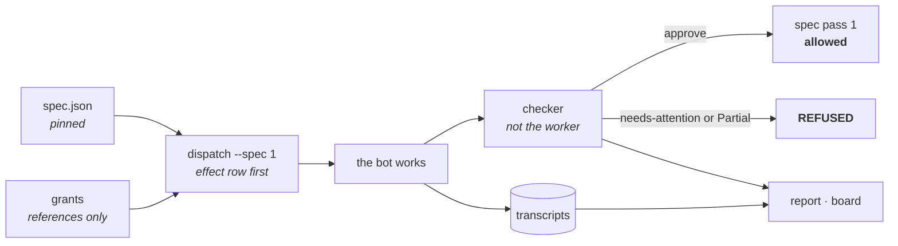
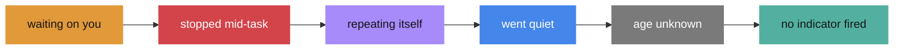
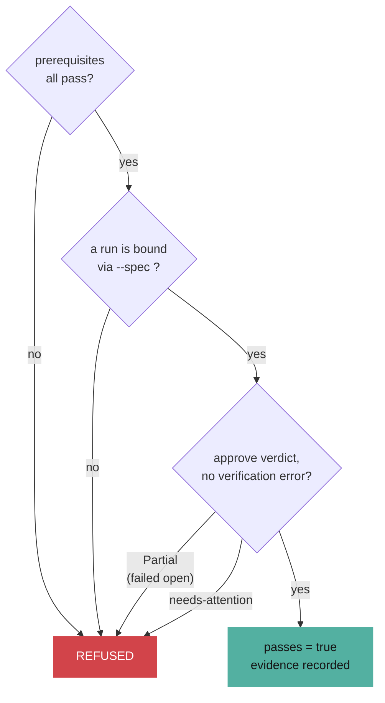

<p align="center">
  
</p>

<p align="center">
  <a href="https://github.com/Archive228/foreman/actions/workflows/ci.yml"></a>
  
  
  
  
  
</p>

Grok Bot is a hosted product. There is no dry run, no per-bot spend, no rollback
after an approval, and every bot on the account shares one VM. `foreman` is the
layer you can own: crews declared in git, reconciled against `gbot --json`, one
write path to the account, and a shift report that never invents a number.

**Every feature here closes one way a crew can lie to you.**

| The lie | What foreman does | Command |
|---|---|---|
| “work is progressing” | one card per bot, worst first, evidence behind every claim | `foreman board` |
| “each bot has its own computer” | prints the gap between your grants and one shared VM | `foreman exposure` |
| “it’s done” | an entry flips only on a verdict from a grader that is not the worker | `foreman spec` |
| “here’s what it cost” | **nothing.** Grok Bot does not expose it, so neither does foreman | — |

---

## Install

```sh
git clone https://github.com/Archive228/foreman && cd foreman
./init.sh
npm link
foreman doctor --declared
```

| | |
|---|---|
| **Required** | Node 18+ |
| **For live collection** | an authenticated `gbot` on `PATH` |
| **Optional** | a Chromium-family browser, for PNG output only |
| **Runtime dependencies** | zero. TypeScript is dev-only and pinned |

```sh
cp foreman.config.example.json foreman.config.json
```

---

## A shift, end to end



The useful question is not “how many dollars did this bot spend?” — Grok Bot
does not expose that number. The useful question is **where did work stop,
repeat itself, miss a handoff, or wait on me?** Foreman answers only from
evidence it can retain and show you.

This is the observability layer for
[`overnight`](https://github.com/Archive228/overnight). Exact xAI render costs
belong to [`imagine-mcp`](https://github.com/Archive228/imagine-mcp).

---

## The board

```sh
foreman board            # http://127.0.0.1:8788
```

<p align="center">
  
</p>

One card per bot, one state per card, worst first. Click a card and it prints
the detections behind that state and the path to the transcript they came from,
so the claim on the card is never the last word.

**A bot with nothing firing reads `no indicator fired`, not `healthy`.** Those
are different statements, and the board only makes the one it can support.

State precedence, worst first:



`waiting on you` outranks `went quiet` for the same bot on purpose: a bot whose
latest event is an ask is not merely silent, it is silent *because it is blocked
on a person*. Roster drift, and a dropped handoff naming a bot that is not on
the account, are printed as board notes rather than invented into cards.

The page is a **view**. It binds loopback, answers `GET` on three paths, and has
no route that can dispatch, approve, or write to the account. A refresh that
cannot reach `gbot` keeps the last observation on screen and marks it `stale`
instead of blanking or guessing.

Two fixture servers are checked in, so the board can be seen without an
account. Both label themselves in the shift key, because a screenshot of
fixture data must never read as an observation.

```sh
node scripts/board-fixture.mjs     # one frozen shift — the screenshot above
node scripts/board-demo.mjs        # a scripted night, nine beats, looping
```

The demo walks a crew from clean to stalled, looping, a dropped handoff, a
shared-VM collision, a silent bot, an unverified claim, a routine that never
came back, and finally a bot parked waiting on a person. The cards reorder
themselves as it goes — that motion is the precedence rule above, not an
animation laid on top.

---

## Done is not a claim

A coding agent that can edit the description can move the goalposts to wherever
it happened to land, and every later session inherits the moved goalposts as if
they were the original ask. So each `spec.json` entry is **pinned** when written:
a hash over category, description, steps, and prerequisites.

```sh
foreman spec add "Login with email and password" \
  --steps "open /login|submit valid credentials|check the session survives a refresh"
foreman spec next
foreman dispatch worker "implement login" --spec 1
foreman spec pass 1
```

```text
REFUSED: no approve verdict on file for any run bound to spec 1
```

Three conditions, and the middle one is what agents route around:



That third condition **excludes `Partial`**. Foreman's verification fails open
by design: when it cannot run, it records `Partial` and says so. If `Partial`
satisfied this gate, then “verification could not run” would become the cheapest
route through the gate that exists to catch exactly that.

Reopening an entry needs no evidence at all — only passing does. Outcomes
(`passes`, `passedAt`, `evidence`) sit outside the pin, so recording that
something passed never requires re-pinning what it was.

Edit a description after the fact and every command that reads the file stops:

```text
spec.json does not match its own pins:
  ! spec 1: description, steps, category, or prerequisites changed after the entry was written
```

Foreman cannot stop an editor from changing the file. It can refuse to pretend
the changed file is the one that was agreed. `dispatch` needs `--spec <id>` or
an explicit `--no-spec`, and `--no-spec` writes a `spec-waived` row to the audit
chain: working with no declared definition of done is a choice, and it leaves a
mark.

---

## One computer

Grok Bot documents it plainly: every bot on the account shares one persistent
cloud computer — files, browser, logins — and **isolation is per user, not per
bot**. Whatever one of them can reach, all of them can reach.

Foreman cannot fix that. It is a harness, not a sandbox. What it can do is write
down what you *meant* each bot to reach, and print the distance to what the
account actually hands out.

```sh
foreman grants grant publisher --service x --scopes read,draft --ref env:X_TOKEN
foreman exposure
```

```text
  grants declare (mean per bot)       1.50   a bot should reach only what a grant names
  one shared VM hands out                3   every bot inherits every login
  gap                                 1.50   services per bot that no grant asked for
```

Both numbers come out of the same file, so the comparison is arithmetic rather
than opinion. **The gap is not a score to improve. It is the shared VM.**

A grant holds a *reference*, never a secret — which is why `data/grants.json` is
safe to read and to commit:

| Accepted | Refused |
|---|---|
| `env:X_TOKEN` | `sk-live-9f2c8ab441de` |
| `file:~/.secrets/x` | any value without a scheme prefix |
| `keychain:zendesk/support` | |
| `op://vault/item` | |

A pasted token fails at the door instead of landing in git. And foreman **never
resolves a reference**: it does not read your keychain to draw a dashboard, and
it will not claim a credential still works when it has not looked.

`foreman gate` returns one of three verdicts, and the middle one is the point:

| Verdict | Meaning |
|---|---|
| `denied` | no grant, wrong scope, or expired — **a configuration bug** |
| `held` | the grant covers it, the bot's profile says a person decides — **the system working** |
| `allowed` | a live grant covers it |

Every grant, revoke, and gate decision appends to `data/audit.jsonl`, where each
row carries the hash of the row before it. `foreman audit --verify` walks the
chain and names the first row that was edited, removed, or reordered:

```text
Audit chain broken at row 2: row 2 was edited after it was written.
```

An append-only log nobody checks is a log nobody can trust. The gate itself is
advisory: it cannot hold a Grok Bot turn open and it cannot revoke a login the
account already has. It records what it decided and why.

---

## The crew that runs while you sleep

```sh
foreman crew status
```

```text
  BOT                 LIVE  ROUTINE               NEXT RUN              LAST SEEN
  ----------------------------------------------------------------------------------------
  foreman             NO    morning-report        2026-09-02 09:00:00Z  —
  checker             NO    none                  —                     —

  FINDINGS
  ! no live group named "foreman-core" was observed; the crew exists in git only
  ! checker has no routine; it only works when something sends to it
```

A crew is only a crew that works overnight if something wakes it. The `schedule`
field used to be free text: a cron typo shipped silently, and the first symptom
was a bot that never woke, with nothing anywhere saying why.

It is parsed now — five fields, ranges, lists, steps, Sunday as both `0` and `7`,
and the standard rule that a restricted day-of-month and a restricted day-of-week
combine as a **union**. `sync plan` prints the next run beside every routine and
refuses to stay quiet about one it cannot read.

The five-minute floor comes from
[`cubicle`](https://github.com/Archive228/cubicle): a bot that wakes constantly
is a bot nobody reads. Foreman **warns rather than refuses** — it does not own
the product's timer, so pretending to enforce a floor would be theatre.

For the shape of a six-bot crew that actually ships something overnight — a chief
that owns sequence, bounded specialists, an independent gate, and a publisher
that stops at a human — see [`overnight`](https://github.com/Archive228/overnight).

---

## Commands

**Look**

| Command | What it does |
|---|---|
| `foreman board` | The live page on `127.0.0.1`. Read-only, `GET` on three paths. |
| `foreman report` / `watch` | Shift report, twelve indicators. Optional PNG. |
| `foreman inspect [--json]` | Declared vs live. Slot budget. Collisions. Provenance. |
| `foreman crew statu

<!-- truncated for Mythos neural library -->
